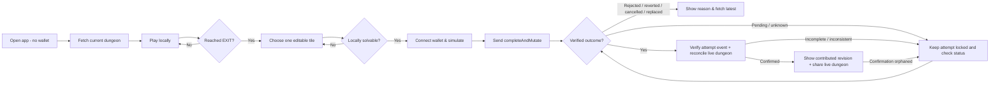
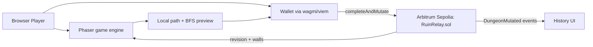

# Ruin Relay — Product Requirements Document (PRD)

> **Versi:** 1.0 — Hackathon scope lock  
> **Tanggal:** 10 Oktober 2026  
> **Status:** Spesifikasi siap implementasi; bukan pernyataan bahwa fitur sudah dibangun  
> **Target:** Colosseum Crypto World's Fair 2026 — Arbitrum track  
> **Bahasa dokumen kerja:** Indonesia. **Seluruh konten submission resmi: English.**  
> **Rujukan teknis utama:** [`ADR.md`](ADR.md), [`reference/fixtures.json`](reference/fixtures.json), [`reference/IRuinRelay.sol`](reference/IRuinRelay.sol), [`TEST_PLAN.md`](TEST_PLAN.md).

## 0. Ringkasan eksekutif

**Ruin Relay** adalah game browser puzzle dungeon asinkron: semua pemain menghadapi **satu dungeon bersama**; pemain yang berhasil keluar memperoleh kesempatan mengubah **tepat satu tile** untuk menjadi tantangan pemain berikutnya. Peta dan urutan edit resmi dikelola kontrak di **Arbitrum Sepolia**. Bermain dan bergerak tidak memerlukan wallet; wallet hanya diperlukan ketika pemain memutuskan untuk menulis kontribusi permanen ke chain.

**Kalimat produk:** *Escape the dungeon. Change one tile. Challenge everyone after you.*

**Core loop:** Buka game → baca peta revisi N → arahkan karakter dari START ke EXIT → pilih satu tile yang boleh diedit → pratinjau dan pastikan peta tetap punya solusi → tandatangani satu transaksi → peta menjadi revisi N+1 → bagikan tautannya.

**Hipotesis utama:** hak untuk mengubah **dunia bersama** setelah berhasil menyelesaikannya lebih memotivasi pemain kembali dan mengajak teman dibanding scoreboard onchain yang tidak mengubah gameplay. Hipotesis ini belum divalidasi pada pengguna sungguhan.

### Kartu keputusan MVP

| Parameter | Keputusan |
|---|---|
| Target platform | Browser desktop terlebih dahulu; tampilan mobile responsif untuk membaca/menonton |
| Gameplay | Single-player per percobaan; multiplayer asinkron melalui board state publik |
| Board | Tetap 7×7 = 49 tile; satu global dungeon |
| Kontrol | Arrow keys / WASD; tombol restart; timer lokal hanya kosmetik |
| Tile | Lantai / dinding, START dan EXIT tidak bisa berubah |
| Edit | Toggle 1 tile yang termasuk editable mask, setelah submit jalur valid |
| Smart contract | Satu kontrak immutable `RuinRelay`, satu transaksi `completeAndMutate` |
| Solvability | BFS terikat maksimum 49 tile dihitung onchain setelah toggle |
| Proof of completion | Jalur langkah dikodekan dan diperiksa onchain; **bukan bukti pemain manusia/bermain tanpa bot** |
| Revisi | Compare-and-swap `expectedRevision`; hanya satu mutasi bisa menang untuk satu revisi |
| Data historis | Event log onchain; state saat ini disimpan langsung di storage kontrak |
| Reward | Kredit kontributor dan riwayat yang dapat diverifikasi; **tidak ada token, NFT, uang, atau staking** |
| Chain | Arbitrum Sepolia, chain ID `421614` |
| Prioritas | Gameplay selesai, kontrak aman, transaksi nyata, dua revisi berbeda, demo English |

## 1. Konteks & masalah

### 1.1 Masalah pemain

Game puzzle biasa mempunyai dunia statis: selesai level, pemain jarang memiliki dampak terhadap pengalaman orang berikutnya. Game level-editor komunitas mengizinkan pengguna membangun level pribadi, tetapi proses bermain dan membuat level sering menjadi dua kegiatan yang terpisah. Di Ruin Relay, **menyelesaikan tantangan adalah izin untuk mengubah tantangan yang sama**.

### 1.2 Mengapa blockchain masuk akal

Permainan membutuhkan satu sumber kebenaran untuk: (a) peta terkini, (b) urutan edit oleh akun berbeda, dan (c) verifikasi aturan transisi yang sama untuk semua pemain. Kontrak publik memberi transisi state yang bisa diperiksa oleh klien berbeda; tidak ada server privat yang dapat diam-diam mengganti riwayat edit. **Tidak semua gameplay berlangsung di chain**: animasi dan gerakan tetap lokal agar cepat. Biaya dan kebutuhan wallet adalah trade-off, bukan manfaat tersendiri.

### 1.3 Prior art dan posisi klaim

- **Meet Your Maker:** build-and-raid dengan level milik pemain; Ruin Relay membatasi permainan pada **satu papan global yang dimodifikasi bergiliran**.
- **Super Mario Maker:** pembuatan level komunitas; Ruin Relay mengaitkan izin edit ke solusi puzzle pada revisi yang sedang aktif.
- **Autonomous worlds / fully-onchain games:** state game onchain bukan kebaruan tersendiri.

**Klaim yang diperbolehkan:** "A small, shared dungeon that evolves one verified escape at a time." **Hindari:** "world's first onchain dungeon", "bot-proof", "real-time massively multiplayer", "fully decentralized UI", dan "fair reward economy".

## 2. Sasaran bisnis, produk, dan kriteria berhasil

### 2.1 Tujuan P0 (wajib untuk submission)

1. Pemain dapat memulai puzzle revisi aktif dan menyelesaikannya tanpa menandatangani transaksi saat bergerak.
2. Setelah mencapai EXIT, pemain memilih satu tile yang dapat diedit, melihat preview, dan menerima transaksi onchain untuk memperbarui papan.
3. Kontrak menerima **hanya** jalur benar terhadap peta revisi yang diajukan dan hanya perubahan yang mempertahankan solvability.
4. Pengunjung lain dapat melihat revisi baru dari akun/perangkat lain tanpa backend otoritatif.
5. Demo menunjukkan dua mutasi berurutan (rev 0→1→2) dan riwayat actor, tile, block/tx.
6. Repository, dokumentasi, deploy link, dan dua video dalam bahasa Inggris siap sebelum deadline internal.

### 2.2 Sasaran kualitas (target engineering, bukan hasil saat ini)

| Metrik | Target / cara mengukur |
|---|---|
| Playability | 100% jalur dari seed resmi sampai EXIT berjalan sesuai validator lokal dan kontrak |
| Solvability invariant | Tidak ada sequence mutasi yang sukses menghasilkan dungeon tanpa rute |
| Konsistensi client | Revisi dan wall mask UI sama dengan `getDungeon()` pada block yang dibaca |
| First playable | Target ≤15 detik sejak halaman siap; diukur manual pada laptop test |
| Movement feedback | 60 FPS target pada desktop lazim; tidak memerlukan transaksi per langkah |
| Mutasi chain | Satu permintaan wallet; selesai ketika receipt sukses + event state terverifikasi |
| Gas | Diukur dengan `forge snapshot` dan pada Sepolia; optimasi jika mutation melebihi budget yang disepakati tim (target awal 1,5 juta gas, **bukan jaminan biaya**) |
| Keandalan demo | Dua akun wallet berbeda pada browser/profil A dan B; dua mutation berurutan rev0→1→2 dari deployment Sepolia yang sama |

### 2.3 Hipotesis discovery pascahackathon

- H1: mayoritas pemain uji memahami loop solve→edit dalam satu sesi singkat tanpa penjelasan langsung.
- H2: sebagian pemain ingin kembali ketika orang lain telah mengubah dungeon yang pernah mereka edit.
- H3: pemain bersedia menghubungkan wallet **setelah** menerima rasa kepemilikan terhadap kontribusi, bukan di layar awal.

Validasi H1–H3 memerlukan uji pemain dan pengukuran, **tidak boleh diklaim sebagai traction yang sudah ada**.

## 3. Pengguna, aktor, dan job-to-be-done

| Aktor | Kebutuhan | Hak/aksi |
|---|---|---|
| Visitor / Spectator | Memahami game dengan cepat | Melihat papan sekarang, histori, aturan, network |
| Solver | Bermain tanpa friksi | Menggerakkan karakter lokal, restart, melihat langkah dan hasil |
| Editor / Contributor | Mengubah dunia setelah menang | Memilih satu tile, preview legalitas, mengirim transaksi |
| Returning player | Melihat dampak edit sebelumnya | Melihat revisi, editor terakhir, share link, riwayat |
| Juri / reviewer | Memastikan penggunaan chain nyata | Buka explorer, lihat kontrak verified, lihat before/after |
| Operator tim | Deploy, monitoring, demo | Siapkan seed, kontrak, RPC, observability ringan; **tidak ada admin cheat pada kontrak produksi MVP** |

### User stories

- **US-01** Sebagai visitor, saya ingin menekan **Play** dan langsung melihat papan tanpa harus konek wallet.
- **US-02** Sebagai solver, saya ingin menyelesaikan dungeon dengan WASD/arrow keys, menekan **R** untuk restart, dan melihat langkah saya.
- **US-03** Sebagai solver, saya ingin tahu kapan snapshot peta saya kedaluwarsa sebelum menghabiskan gas.
- **US-04** Sebagai pemenang, saya ingin mengubah satu tile dan tahu apakah dungeon tetap solvable.
- **US-05** Sebagai editor, saya ingin melihat biaya jaringan serta isi operasi sebelum persetujuan wallet.
- **US-06** Sebagai pemain lain, saya ingin memuat revisi terbaru dan melihat perubahan yang dibuat pendahulu saya.
- **US-07** Sebagai reviewer, saya ingin memverifikasi transaksi dan replay dengan fixture deterministik.

## 4. Prinsip desain produk

1. **Game first:** aktivitas utama adalah bermain, bukan transaksi.
2. **One meaningful onchain action:** satu mutasi sukses = satu perubahan peta dan satu kredit kontributor.
3. **Rules are executable:** backend atau UI tidak boleh mengesahkan mutasi yang tidak akan diterima kontrak.
4. **Small but legible:** 7×7 cukup untuk diperiksa manusia, murah direpresentasikan, dan tidak bergantung pada AI dungeon generation.
5. **Public and composable:** data state dapat dibaca melalui ABI oleh klien lain.
6. **Honest Web3 UX:** solusi bisa disalin dari transaksi lama; wallet membuktikan sender, bukan manusia unik.
7. **No economic exploits:** tidak ada aset bernilai yang bergantung pada skor offchain.

## 5. Gameplay spesifikasi terperinci

### 5.1 Dunia dan koordinat

- Ukuran: **7 kolom × 7 baris**; total **49 tile**.
- Koordinat: `(x,y)`, `0 ≤ x,y < 7`; indeks linear `i = y*7 + x`.
- `START = 0` pada `(0,0)`; `EXIT = 48` pada `(6,6)`.
- Tipe tile: **floor** (bit 0) dan **wall** (bit 1).
- `walls` adalah `uint64`, hanya bit 0–48 boleh dipakai; bit 49–63 wajib nol.
- Penempatan karakter, tekstur dan animasi tidak memengaruhi validitas kontrak.
- `START`/`EXIT` tidak boleh menjadi dinding atau tile editable.

**Peta seed referensi** (ASCII; `S` = START, `E` = EXIT, `#` = wall, `.` = floor):

```text
S#.#...
.....#.
.####..
#.....#
##..#.#
.....#.
##....E
```

Konstanta fixture: `initialWalls=0x0d053827900a`, `initialRevision=0`, `editableMask=0x01f9e7e1cf00`. *Leading zero* pada representasi hex tidak bermakna; file `reference/fixtures.json` adalah nilai kanonik. Grid seed mempunyai solusi valid 20 langkah dan paling sedikit dua pilihan perubahan berurutan yang mempertahankan solvability.

### 5.2 Aturan pergerakan

- Tombol **W/↑ = up**, **D/→ = right**, **S/↓ = down**, **A/← = left**.
- Tidak boleh menembus dinding atau keluar batas; gerakan ilegal tidak dicatat.
- Setiap gerakan legal menambahkan satu arah ke path lokal; dapat kembali ke tile sebelumnya.
- `MAX_MOVES = 96`; setelah mencapai batas, UI meminta restart; smart contract menolak input melebihi 96.
- Ketika mencapai EXIT, path dibekukan dan UI masuk mode edit. Untuk mengulang, tekan **Restart**.
- Waktu tempuh dan jumlah langkah boleh ditampilkan, tetapi **tidak digunakan sebagai dasar pemberian uang/leaderboard onchain**.
- Boleh berjalan langsung tanpa wallet. Wallet diminta hanya saat menekan **Commit Edit**.

### 5.3 Aturan editor

- Mode edit terbuka **hanya setelah path lokal mencapai EXIT**.
- Pemain memilih **satu** tile pada daftar editable mask; tile START/EXIT tidak dapat dipilih.
- Aksi mutasi adalah **toggle** `floor→wall` atau `wall→floor`, bukan menaruh item bebas.
- UI menghitung preview solvability secara lokal dengan BFS; jika tidak solvable, tombol transaksi nonaktif.
- Smart contract melakukan verifikasi ulang; preview UI **bukan sumber otoritas**.
- Pemain bisa batal tanpa onchain action.
- Commit sukses menghasilkan tepat satu revisi kontribusi dan satu entri history. UI menampilkan revisi kontribusi tersebut serta live dungeon terbaru secara terpisah, termasuk bila pemain lain sudah mengubah dungeon lagi.
- History mencatat wallet editor (alamat publik) dan tile index. Nickname tidak diperlukan.
- Saat commit memasuki signing, run dan pilihan edit dibekukan sebagai satu commit attempt. Perubahan tile, Restart, Play latest, dan submit ulang dinonaktifkan selama signing/pending/unknown/syncing; history tetap dapat dilihat. Penolakan wallet mengembalikan editor dengan run dan tile yang dipertahankan; aturan stale tetap berlaku.

### 5.4 Verifikasi lintasan onchain

Satu transaksi `completeAndMutate(expectedRevision, packedDirections, moveCount, tileIndex)` melakukan seluruh pengecekan berikut secara atomik:

1. `expectedRevision == revision saat ini`.
2. `moveCount` di rentang 1..96; bit ekstra dalam `packedDirections` adalah nol (encoding kanonik).
3. Berangkat dari START; tiap arah valid terhadap batas papan dan `walls` lama.
4. Exit hanya dicapai pada **langkah terakhir**; path berakhir di EXIT.
5. `tileIndex` termasuk editable mask, bukan START/EXIT.
6. Toggle satu tile menghasilkan `walls baru` dengan bit valid.
7. `walls baru` mempunyai jalur START→EXIT (BFS onchain).
8. Setelah semua valid, update wall mask + revision dan emit event.

**Penting:** transaksi memuat solusi path dari revisi **sebelum perubahan**, bukan path untuk dungeon hasil perubahan. Riwayat path lama menjadi publik. Kontrak memvalidasi matematis, **tidak** menjamin pemain memasukkan langkah manual atau tidak memakai bot.

### 5.5 Race dan versi

- Saat menekan Play, client menyimpan snapshot `revision` dan `walls`.
- Polling dan refetch memperbarui live dungeon tanpa mengganti snapshot run yang sedang dimainkan atau diedit. Run yang menjadi stale boleh diselesaikan sebagai latihan; Commit dinonaktifkan.
- Saat revisi berbeda, HUD menampilkan **"Playing revision N · Live revision M"**. **Restart** mengulang run pada snapshot yang sama; **Play latest** membuang path dan edit draft lama lalu memulai run baru dari START pada live dungeon. Lihat [ADR-029](docs/adr/0029-frozen-run-snapshot.md).
- Jika pemain lain berhasil submit dulu, transaksi terhadap snapshot lama harus gagal dengan `StaleRevision(expected, actual)`.
- Client melakukan preflight terbaru sebelum meminta wallet; tetap mungkin ada race antarpengguna sampai transaksi masuk.
- Setelah race, tampilkan **"The dungeon changed while you were playing. Play the new version."**
- Jangan otomatis mengirim ulang transaksi atau mengenakan biaya baru tanpa izin pengguna.
- Saat RPC hilang, permainan lokal pada snapshot dapat diteruskan untuk hiburan, namun **Commit Edit** dinonaktifkan sampai state bisa divalidasi lagi.
- Snapshot yang layout-nya berbeda dari live dungeon tetap stale walaupun nomor revisinya sama, termasuk setelah reorg. Unresolved commit attempt tetap mengikuti aturan lock dan recovery; offline play tidak membuka kembali attempt yang belum selesai.

### 5.6 Keberhasilan dan kegagalan

| Kondisi | Perilaku |
|---|---|
| Menyentuh EXIT | Freeze movement, tampilkan overlay "Dungeon Escaped!" dan mode edit |
| Tile edit legal | Highlight biru/hijau dan preview peta; Commit tersedia hanya untuk snapshot yang masih eligible, state dapat diverifikasi, dan tidak ada unresolved attempt pada scope deployment; validasi wallet/preflight tetap wajib sebelum signing |
| Tile membuat dungeon buntu | Highlight merah, jelaskan bahwa harus ada jalur START→EXIT |
| Wallet belum terhubung | Modal Connect wallet hanya pada Commit |
| Wallet di network salah | Tawarkan switch ke Arbitrum Sepolia dan instruksi manual |
| User reject signature | Batalkan tanpa kehilangan sesi lokal; tidak dianggap sukses |
| Pending transaction | Tile tidak permanen; tampilkan waiting state dan explorer link |
| RPC timeout setelah pengajuan | Pertahankan attempt sebagai unresolved; tampilkan Retry status dan link wallet/explorer; commit baru tetap terkunci |
| Respons wallet hilang sebelum hash diketahui | Tampilkan Recover with transaction hash dan panduan wallet/explorer; verifikasi hash terhadap attempt; bukti ambigu tetap unresolved |
| Reload dengan attempt belum selesai | Pulihkan attempt, run, edit draft, dan hash yang diketahui dari jurnal lokal; verifikasi chain sebelum mengubah status atau membuka commit |
| Jurnal awal gagal disimpan | Tetap izinkan local play; jelaskan recovery tidak tersedia dan blok permintaan signing |
| Tab lain mempunyai unresolved attempt pada deployment yang sama | Blok commit baru di semua tab site dalam profil browser yang sama, termasuk setelah berganti akun; tampilkan status/recovery attempt tersebut |
| Transaction confirmed success | Verifikasi receipt/event terhadap commit attempt, rekonsiliasi live dungeon, lalu tampilkan revisi kontribusi dan revisi live secara terpisah |
| Transaction revert / stale | Tidak ubah state lokal sebagai committed; tampilkan error actionable |
| Wallet speed-up | Ikuti hash pengganti untuk aksi yang sama; verifikasi receipt/event seperti attempt original |
| Cancellation / replacement dengan aksi berbeda terkonfirmasi | Akhiri attempt tanpa mengklaim keberhasilan edit; refetch dungeon dan buka editor sesuai aturan stale |
| Confirmation hilang akibat reorg | Tarik success, periksa ulang attempt, hapus history orphaned, dan rekonsiliasi live dungeon |
| Event log gagal dimuat | State saat ini tetap bisa dimainkan; history diberi label unavailable |

### 5.7 Replayability & anti-grief batas MVP

Dunia dapat diubah kembali oleh orang lain, termasuk mengembalikan tile ke keadaan sebelumnya. Itu perilaku yang diperbolehkan MVP. Tanpa gate identitas yang tahan Sybil atau reward, pihak jahat dapat menyelesaikan puzzle memakai script lalu melakukan banyak mutasi. Biaya gas menjadi hambatan ringan, **bukan proteksi keamanan**. Pada tahap berikutnya dapat diperkenalkan epoch, voting, puzzle pool, edit cooldown, atau kontribusi terkurasi berdasarkan hasil uji pengguna. Jangan klaim bahwa model saat ini censorship-resistant *dan* anti-grief sekaligus.

## 6. Alur produk dan information architecture

### 6.1 Sitemap MVP

```text
/                       Landing + CTA "Play the dungeon"
/play                   Game board, current revision, local run, edit preview
/history                Event history + latest mutation, network/explorer links
/about                  Cara kerja + mengapa Arbitrum + risiko publikasi solusi
```

Layar game dapat mencakup modal wallet dan transaksi tanpa route terpisah. Link `/play?revision=N` **tidak menjamin replay historis** jika implementasi belum mempunyai rekonstruksi event yang andal: arahkan ke info revision / current game atau berikan label historical preview.

### 6.2 Diagram perjalanan



### 6.3 Layar dan komponen

| Komponen | Isi minimum | UX note |
|---|---|---|
| Header | Ruin Relay, network, revision | Jangan seolah wallet wajib untuk bermain |
| Grid | 49 tile, start, exit, player sprite, visited trail opsional | Grid accessible via visual + legend |
| HUD | Steps, status, restart, help | Hide gas until mutating |
| Victory overlay | Selesai, tombol edit / replay | Tidak menyatakan onchain success |
| Edit overlay | Toggle candidate, before/after, solvable/blocked | Simpan selected tile, batalkan mudah |
| Wallet sheet | Chain, address, operation summary, tx risk | Tidak minta approval ERC20/NFT |
| TX state | Signing, Pending, Still checking, Syncing, Confirmed, atau hasil gagal/batal terverifikasi | Sediakan Retry status dan link wallet/explorer; reorg dapat menarik confirmation |
| Mutation history | Revision, tile, editor, transaction | Pagination dan "loading" state |
| About/How-it-works | Narasi pengubahan bersama & keterbatasan | Hindari "anti-cheat" palsu |

**Arah visual MVP:** dungeon sederhana dengan tile batu gelap, START/EXIT yang mudah dibedakan, karakter petualang sederhana, serta highlight before/after yang kuat saat memilih edit. Gunakan artwork geometris original dan label/simbol bersama warna untuk status; sprite kompleks dan animasi dekoratif tetap P1.

### 6.4 Copy produk — English untuk aplikasi dan submission

- Hero: **"Escape it. Change it. Leave it for the next player."**
- Supporting: **"One shared dungeon. Every verified escape can reshape one tile."**
- CTA: **"Play without a wallet"**.
- After escape: **"You escaped Revision #N. Choose one tile to change."**
- Solvable: **"Your edit keeps an escape route open."**
- Invalid: **"That edit blocks every route to the exit."**
- Commit: **"Commit one change on Arbitrum"**.
- Pending: **"Waiting for your transaction to confirm. Your edit is not confirmed yet."**
- Unresolved: **"Still checking your transaction."** CTA **"Retry status"** hanya membaca ulang hasil.
- Hash belum diketahui: **"Check your wallet for this transaction."** CTA **"Recover with transaction hash"** menerima hash untuk diverifikasi; hash yang tidak cocok tidak mengubah attempt.
- Attempt di tab lain: **"An edit is already in progress for this dungeon. Check its status before submitting another."**
- Reorg: **"Your edit's confirmation changed. Checking again."**
- Stale: **"Someone changed the dungeon first. Try the new revision."**
- Success: **"Your edit created revision #N."** Tampilkan **"The dungeon is now at revision #M."** secara terpisah; N adalah revisi kontribusi dan M adalah revisi live terbaru yang berhasil dibaca.

## 7. Daftar kebutuhan fungsional (FR)

**Prioritas:** P0 wajib demo; P1 jika waktu cukup; P2 setelah hackathon. Semua FR-P0 harus memiliki tes.

| ID | Prioritas | Requirement | Kriteria penerimaan ringkas |
|---|---|---|---|
| FR-01 | P0 | Pengunjung bermain tanpa wallet | `/play` memuat current board dan kontrol aktif |
| FR-02 | P0 | Render grid 7×7 berdasar `walls` onchain | 49 tile dan index row-major konsisten |
| FR-03 | P0 | START/EXIT tetap | Keduanya tidak bisa ditoggle |
| FR-04 | P0 | WASD/arrow keys | Tidak dapat keluar board atau melewati wall |
| FR-05 | P0 | Restart run | Path lokal dikosongkan; revisi snapshot tetap |
| FR-06 | P0 | Path dibatasi 96 langkah | UI dan kontrak konsisten |
| FR-07 | P0 | Victory hanya saat mencapai exit | Overlay setelah langkah terakhir ke EXIT |
| FR-08 | P0 | Edit hanya setelah victory lokal | Tombol Commit tersembunyi/nonaktif sebelum victory |
| FR-09 | P0 | Tile editable whitelist | Noneditable disabled dan ditolak kontrak |
| FR-10 | P0 | Tepat satu tile toggle | XOR satu bit dan revision+1 |
| FR-11 | P0 | Preview solvability | Lokally reject dead map; kontrak recheck |
| FR-12 | P0 | Jalur verifiable onchain | Langkah illegal/wall/early exit ditolak |
| FR-13 | P0 | Atomic solve+edit tx | Tidak ada edit tanpa valid path |
| FR-14 | P0 | Atomic revision compare | Stale version ditolak |
| FR-15 | P0 | Immutable current board state | Query dari contract tanpa API privat |
| FR-16 | P0 | Event riwayat mutasi | `DungeonMutated` berisi rev, editor, tile, mask |
| FR-17 | P0 | Connect wallet hanya saat commit | Read-only dan play tanpa wallet |
| FR-18 | P0 | Network Arbitrum Sepolia | Validasi `chainId=421614` |
| FR-19 | P0 | Preflight + gas estimate | `simulateContract` dan estimasi sebelum tx |
| FR-20 | P0 | Status transaksi akurat | Confirmed hanya setelah receipt success, event cocok dengan commit attempt, dan rekonsiliasi live state sesuai ADR §C.5 |
| FR-21 | P0 | Error states actionable | Rejected, stale, wrong network, RPC, revert |
| FR-22 | P0 | UI history latest edits | Minimal latest 10 event terbaru atau fallback current |
| FR-23 | P0 | Share current dungeon | URL publik tanpa penyimpanan rahasia |
| FR-24 | P0 | Explorer + verified ABI link | Kontrak, event, tx bisa diperiksa reviewer |
| FR-25 | P0 | Seed fixture versi kanonik | Rev0→1→2 bisa direproduksi dari fixture |
| FR-26 | P0 | Dokumentasi dan demo English | README, pitch, video, source links |
| FR-27 | P1 | Visual highlights shortest/visited | Tidak membocorkan solusi otomatis di awal |
| FR-28 | P1 | Reconstruct historical revisions | Event scan dengan integritas check dan paging |
| FR-29 | P1 | Mobile touch controls | Bergerak via D-pad tap |
| FR-30 | P1 | Public contribution stats | Hitung jumlah edit wallet via logs |
| FR-31 | P2 | Multi-dungeon/season | Factory atau registry terpisah |
| FR-32 | P2 | Rule modules (traps, pressure plates) | Batas state dan anti-grief ditinjau ulang |
| FR-33 | P2 | Gas-sponsored onboarding | Ancaman penyalahgunaan dan biaya sponsor perlu riset |
| FR-34 | P2 | Tournaments & social challenges | Tanpa token rewards sampai integritas scoring memadai |

## 8. Persyaratan nonfungsional (NFR)

| ID | Area | Persyaratan / verifikasi |
|---|---|---|
| NFR-01 | Determinisme | Solidity dan TypeScript punya test vector identik untuk path, mask, BFS |
| NFR-02 | Integritas | Setiap state yang sukses mempunyai solusi START→EXIT |
| NFR-03 | Safety | Smart contract tidak menerima/menyimpan dana pengguna |
| NFR-04 | Authorization | Mutasi hanya valid melalui proof path; kontrak tidak punya owner edit arbitrer |
| NFR-05 | Liveness | Jika RPC offline, grid cached diberi label offline/stale, mutasi disabled |
| NFR-06 | Observability | Event per mutation, tx link, deployment metadata |
| NFR-07 | Transparency | Kontrak verified, source mit LICENSE, address di README |
| NFR-08 | UX | Gameplay tidak meminta wallet sampai commit dan error bukan pesan mentah RPC |
| NFR-09 | Usability | Keyboard shortcut terlihat, opsi suara mute, legend warna/wall |
| NFR-10 | Accessibility | Indikator tidak hanya warna; navigasi keyboard; teks status terbaca |
| NFR-11 | Performance | Animasi diproses lokal; satu read untuk state, polling ringan untuk changes |
| NFR-12 | Cost | Gas BFS diukur; tidak hardcode biaya rupiah / ETH |
| NFR-13 | Data | Hanya alamat publik + event chain; tidak mengumpulkan PII tambahan tanpa izin |
| NFR-14 | Integrity | Tidak menganggap solusi onchain sebagai bukti input manusia |
| NFR-15 | Deployment | Node/Next environment tidak menyimpan private key deployment di frontend |
| NFR-16 | Change mgmt | Perubahan ABI setelah kontrak verified memerlukan redeploy + migrasi address |
| NFR-17 | Reliability | Hasil tx direkonsiliasi terhadap `revision` dan `wallMask` dibaca dari chain |
| NFR-18 | Release quality | Seluruh tes P0 lulus, bukti video direkam dari Sepolia nyata |

## 9. Spesifikasi data dan integrasi

### 9.1 State kanonik kontrak

```text
walls:         uint64  // 49 bit valid; 1 = wall
revision:      uint64  // starts 0; increment exactly one per accepted mutation
editableMask:  uint64  // immutable deploy config; endpoint bits cleared
START:         uint8 = 0
EXIT:          uint8 = 48
BOARD_SIZE:    uint8 = 7
MAX_MOVES:     uint8 = 96
```

### 9.2 Payload aksi

```text
completeAndMutate(
  uint64 expectedRevision,
  uint256 packedDirections,
  uint8 moveCount,
  uint8 tileIndex
)
```

**Peta arah (2 bit per langkah, little-endian per step):** `00=UP`, `01=RIGHT`, `10=DOWN`, `11=LEFT`. Arah langkah ke-i berada di `(packedDirections >> (2*i)) & 3`; semua bit di atas `2*moveCount` harus nol. Tidak ada proof time, kecepatan, atau posisi karakter tersembunyi.

### 9.3 Event kanonik

```solidity
event DungeonMutated(
    uint64 indexed revision,
    address indexed editor,
    uint8 indexed tileIndex,
    bool becameWall,
    uint64 wallMask
);
```

History bisa merekonstruksi progress dengan urutan rev: 1,2,...; `revision=0` merupakan seed deployment. Beberapa event yang sama akibat replay log RPC harus dideduplikasi dengan `(chainId, txHash, logIndex)`. Saat ada chain reorg atau perubahan canonical head, lakukan refetch state. Jangan menganggap notifikasi pending sebagai final.

### 9.4 Data sisi client

- `chainSnapshot = {revision, walls, editableMask, chainId, contractAddress, fetchedAtBlock, fetchedAtBlockHash}`.
- `run = {snapshot: chainSnapshot, path: Direction[], position, reachedExit}`; snapshot run tetap, terpisah dari hasil refetch live dungeon.
- `editDraft = {tileIndex, nextWalls, solvablePreview, rejectionReason}`.
- `commitAttempt = {runSnapshot, packedDirections, moveCount, tileIndex, expectedWalls, account, chainId, contractAddress}`; data ditangkap sebelum signing dan tetap selama attempt.
- `observedTransactions = Array<{hash, sender, nonce, target, value, calldata, linkageEvidence}>`; metadata dan bukti pengaitan disimpan hanya ketika telah diperoleh, bukan ditebak bila nonce original belum diketahui.
- `tx = {attempt: commitAttempt, originalHash?, activeHash?, replacementHashes, observedTransactions, state: idle|signing|pending|unknown|syncing|confirmed|rejected|reverted|cancelled|replaced, receiptBlockNumber?, receiptBlockHash?, errorCode}`.
- `confirmedMutation = {revision, editor, tileIndex, wallMask, hash, blockNumber, blockHash}` adalah hasil kontribusi yang diverifikasi, terpisah dari `chainSnapshot` live terbaru. Aturan kecocokan receipt/event dan state dijelaskan pada `ADR.md` §C.5.
- `history = Array<{revision, editor, tile, becameWall, mask, hash, blockNumber, blockHash}>`.

Run biasa dan edit draft yang belum diajukan tetap sementara. Untuk commit attempt, simpan data tetap beserta run/edit yang diperlukan, hash yang diketahui, dan observed transaction metadata dalam jurnal lokal agar reload melanjutkan pemeriksaan attempt, bukan mengulang pengajuan. Koordinasi commit berlaku per origin/profil browser dan pasangan chain/contract, mencakup semua akun wallet; klaim attempt harus atomik lintas tab. Jurnal dan cached success wajib diverifikasi ulang terhadap chain; aturan recovery/replacement/reorg serta verifikasi hash manual ada pada `ADR.md` §C.7.

## 10. Security & threat model produk

| Ancaman | Dampak | Mitigasi MVP | Residual risk |
|---|---|---|---|
| Path palsu / skip dinding | Edit tanpa menyelesaikan maze | Validasi setiap langkah onchain | Script dapat menghitung path tanpa manusia bermain |
| Tile membuat EXIT tak terjangkau | Semua pemain terjebak | BFS onchain setelah toggle | Gameplay dapat tetap terlalu mudah/menjengkelkan |
| Out-of-bounds / bitmask overflow | State invalid | Cek index 0..48, 49-bit mask, max steps | Perlu fuzz/edge testing |
| Frontend mengirim versi lama | Gas terbuang dan UX buruk | `expectedRevision` + simulate + friendly stale | Race antara simulasi dan inclusion tetap mungkin |
| Spam flip-flop tile | Vandalism/monotony | Pembatasan edit mask; tidak ada reward ekonomi | Tidak sepenuhnya dicegah di MVP |
| Bot / replay path publik | Poin contributor tidak fair | Hindari nilai finansial dan klaim anti-bot | Alamat unik bukan pengguna unik |
| Fake explorer/event UI | Kepercayaan salah | Cek address + chain ID + receipt + log | RPC bisa error / terlambat |
| Wallet phishing | User rugi | Satu contract target; no token approvals; tx preview | Risiko umum wallet/UI tetap ada |
| RPC outage / indexer outage | History/read gagal | Public RPC fallback; current board via `eth_call` | Bergantung pada infrastruktur publik untuk UI |
| Malicious dependency / assets | Masalah supply chain | Dependencies pinned dan aset original/berlisensi | Tidak sama dengan audit penuh |

## 11. Prioritas scope dan trade-off

### Must-have (P0)

- Satu board 7×7; dua revisi terverifikasi nyata.
- Satu kontrak Solidity immutable dengan cek route, edit whitelist, BFS, compare revision.
- Phaser canvas, HUD langkah, victory/edit overlay, wallet flow, UI pending/error.
- Deploy Sepolia, verified source, link explorer.
- Riwayat minimal 10 event, current board dari chain.
- Automated unit/fuzz/invariant tests dan test vector tersimpan.
- Dua video, README, deskripsi business hypothesis, aturan sesuai submission.

### Should-have (P1)

- D-pad mobile, custom sprite/animasi halus, scene transitions.
- Historical board reconstruction dengan pagination event.
- Statistik kontribusi publik tanpa leaderboard berhadiah.

### Tidak dibangun untuk hackathon (P2)

- NFT, ERC20, staking, tokenomics, microtransactions, in-game store.
- Level editor bebas, monster AI, trap procedural, PvP live multiplayer.
- Multiplayer sync server dan dedicated game server.
- Cross-chain state, bridge, DAO voting, permissioned editor economy.
- Gasless relay / account abstraction kompleks, zkProof of actual gameplay.

## 12. Model distribusi, pasar, dan monetisasi

**Wedge awal:** pemain yang menyukai puzzle singkat, roguelike micro-challenges, builder communities, dan kompetisi kreatif asinkron. Distribusi awal melalui tautan share setelah mutasi, video replay pendek, komunitas indie game, komunitas dev Arbitrum, dan game jam.

**Venture hypothesis (belum terbukti):** core engine "solve-to-edit shared worlds" dapat menjadi platform mini-game persisten yang dimainkan dan dimodifikasi komunitas; creator dapat meluncurkan board/season berlisensi atau komunitas dapat membayar creator tools/hosting/analytics. **Tidak ada kebutuhan token untuk memvalidasi hipotesis ini**. Untuk satu dungeon saja, ukuran pasar dan monetisasi belum cukup untuk mendukung klaim venture-scale; roadmap harus menunjukkan bagaimana user-generated challenges bisa berkembang secara organik.

**Rencana validasi singkat:** rekrut 5–10 tester non-tim, amati completion rate run pertama, persentase yang memilih edit, masalah UX wallet, dan apakah mereka ingin melihat edit pemain berikutnya. Pelaporan harus memisahkan target dan data observasi; jangan membuat angka traction fiktif.

## 13. Pelaksanaan teknis dan pembagian kerja

### 13.1 Arsitektur ringkas



### 13.2 Satu aplikasi Vite dan proyek Foundry

```text
ruin-relay/
├── src/                     # Vite + React + Phaser; all UI strings in English
│   ├── game/                # Board renderer, input, scenes
│   ├── lib/                 # Contract client and application adapters
│   │   └── rules/           # One internal TS module for board codec, path and BFS
│   ├── components/          # HUD, edit preview, wallet, history
│   └── config/              # Chain/address/ABI checked in
├── contracts/
│   ├── src/RuinRelay.sol
│   ├── test/RuinRelay.t.sol
│   ├── script/Deploy.s.sol
│   └── foundry.toml
├── docs/                    # Agent configuration, subsequent ADRs, screenshots
├── reference/               # canonical fixture & ABI reference
├── GLOSSARY.md              # Shared domain vocabulary
├── PRD.md / ADR.md / TEST_PLAN.md
├── .env.example             # PUBLIC_RPC only, no private keys
└── README.md
```

**Keputusan:** gunakan satu aplikasi Vite di root dan Foundry di `contracts/` untuk mengurangi konfigurasi workspace pada MVP. Semua consumer TypeScript memakai satu modul aturan internal; Solidity dan TypeScript tetap diuji terhadap fixture kanonik yang sama. Pemisahan menjadi workspace/package dapat ditinjau kembali bila ada consumer aplikasi kedua.

### 13.3 Jadwal (WIB; target internal)

| Batas internal | Pekerjaan dan bukti selesai |
|---|---|
| 10 Okt malam | Freeze rules, scaffold repo, ASCII seed, unit tests path/BFS |
| 11 Okt siang | Smart contract + Foundry tests termasuk stale and trapped maze |
| 11 Okt malam | Phaser playable + edit preview + local fixtures |
| 12 Okt siang | Sepolia deploy, wallet flow, real mutation rev 0→1→2 |
| 12 Okt sore | Error UX, event history, verified source, automated tests |
| 12 Okt malam | Feature freeze, capture videos, English pitch/README |
| 13 Okt 09:00 WIB | Target submit internal, link review, screenshot backup |
| 13 Okt 13:59 WIB | Penutupan menurut aturan resmi saat dokumen dibuat; cek perubahan pengumuman |

**Prioritas saat tertinggal:** pertama potong stats/history lengkap → kedua animasi dekoratif → ketiga layar About khusus → keempat mobile controls. **Jangan potong** verifikasi onchain, peta solvable, tx status, atau demo real. Jika hanya satu mutasi berhasil, tunjukkan bukti nyata tersebut sebagai submission yang belum lengkap dan jelaskan keterbatasan; ini belum memenuhi gate MVP dua mutation berurutan. Jangan memalsukan revisi kedua.

### 13.4 Pembagian tim

| Peran | Tanggung jawab | DoD |
|---|---|---|
| Smart contract engineer | Solidity, Foundry, deployment | Invariant/timing/gas tests, verified contract |
| Game/frontend engineer | Phaser + game feel + wallet UI | Play, victory, edit, tx, stale all usable |
| Product/presentation (dapat dirangkap) | Prior-art, tester, pitch, docs, capture | Video, README, portal English, honest claims |

## 14. Demo & submission plan

### 14.1 Video demo produk ≤3 menit

| Timestamp | Yang ditunjukkan | Bukti utama |
|---|---|---|
| 00:00–00:20 | Hero "one dungeon shared by everyone" + board rev0 | Game bukan template marketplace |
| 00:20–00:45 | Pemain A berjalan ke EXIT tanpa wallet | Gameplay langsung berjalan |
| 00:45–01:10 | Memilih tile 31, preview masih solvable | Hak edit diperoleh setelah solve |
| 01:10–01:35 | Wallet commit dan explorer tx nyata; rev0→1 | Arbitrum dipakai untuk rule enforcement |
| 01:35–02:00 | Tab/akun B me-refresh; board terlihat berubah | Dunia persistent dan shared |
| 02:00–02:30 | B memecahkan rev1, toggle tile 38, rev1→2 | Game loop berlanjut antar pemain |
| 02:30–03:00 | History actor, revision, tx, fitur dan roadmap | Akuntabilitas + potensi produk |

Skenario rev0→1→2 menggunakan fixture yang sudah dihitung (`reference/fixtures.json`). Untuk menjaga video singkat, rekam satu alur lengkap nyata, lalu potong bagian tunggu receipt; jangan merekayasa tx atau data.

### 14.2 Video presentasi 2–3 menit (terpisah)

1. Problem & hook: dunia game tradisional tidak memberikan konsekuensi kreatif kepada pemain setelah menyelesaikan tantangan.
2. Insight: win-to-edit turns players into level designers and creates an asynchronous social loop.
3. Product: gameplay+edit, clip 10–20 detik.
4. Why Arbitrum: shared canonical puzzle state and enforceable revision rules, bukan sekadar NFT.
5. Prior art & differensiasi: satu dunia, satu edit, satu versi, perlu run valid.
6. Go-to-market + honest traction: hasil tes nyata jika ada, bukan angka asumsi.
7. Scope dan roadmap.

### 14.3 Checklist portal

- [ ] Semua anggota terdaftar dan tim benar.
- [ ] Nama, tagline, description, chain/tool stack dalam English.
- [ ] GitHub public / akses reviewer sesuai aturan, LICENSE, video, live demo URL.
- [ ] Video presentation 2–3 menit.
- [ ] Video product demo maksimum 3 menit.
- [ ] Contract address, chain ID, explorer link dan deployment tx.
- [ ] Detail prior development work dijelaskan bila ada.
- [ ] Sumber aset/libraries dan kepemilikan IP sesuai lisensi.
- [ ] Validasi permintaan dipisahkan dari hipotesis bisnis.
- [ ] Submit sebelum buffer internal 09:00 WIB; cek jam portal/aturan terbaru.

## 15. Uji penerimaan (ringkasan)

Spesifikasi rinci per test, input, expected output, dan owner terdapat di [`TEST_PLAN.md`](TEST_PLAN.md). Gate P0:

- **Path:** legal/illegal bounds, wall collision, early exit, wrong end, zero moves, >96 moves, high bits bukan nol, repeated positions.
- **Mutation:** editable/immutable tile, wall↔floor, solvable/unsolvable BFS, invalid mask, endpoint constraints.
- **Concurrency:** stale expected revision, two tx same version, revert state unchanged, user reject signature.
- **Client:** path encoding parity fixture, wallet-off play, network mismatch, RPC outage, pending/confirmed/reverted state.
- **History:** current revision and event matching, event re-fetch/dedupe, missing logs fallback.
- **Demo:** dua revisi nyata, wallet A/B, public explorer, link replay, presentation requirements.

## 16. Risks, asumsi, dan keputusan terbuka

| Risiko / asumsi | Level | Owner | Rencana |
|---|---|---|---|
| Solver bot bisa menentukan path instan | Tinggi untuk competitive economy, sedang untuk MVP nonmonetary | Product | No tokens/rewards; jujur pada pitch; explore anti-bot pascaproduk |
| Satu tile perubahan mungkin tak terasa bagi pemain | Sedang | Game | Seed puzzle terkurasi; animasi before/after; tes pengguna |
| Racing tx menyebabkan frustrasi | Sedang | FE/Contract | Compare revision, preflight, stale message, no auto retry |
| Gas BFS terlalu tinggi | Sedang | Contract | Gauge Sepolia; batasi 49 sel; optimasi BFS memory; jika gagal, perkecil board hanya lewat revisi dokumen/deploy baru |
| Pengalaman game terasa terlalu singkat | Sedang | Game | Smooth animations, feedback, history, replay social hook |
| Public RPC rate-limit | Sedang | FE | Lightweight polling 5–10s, fallback RPC jika tersedia, caching tagged stale |
| Ketersediaan faucet testnet | Sedang | Ops | Fund demo wallets jauh sebelum capture |
| Novelty dibanding maker/builder game | Tinggi | Product | Hindari klaim first; tekankan solve-to-edit dan satu shared state |
| Business model terlalu dini | Tinggi | Product | Validasi retention/creator demand dulu; jangan menjual traction palsu |
| Waktu submission singkat | Tinggi | Semua | Lock P0, freeze fitur, submit sebelum 09:00 WIB |

**Keputusan terbuka yang tidak memblokir MVP:** jumlah tile editable bila playtest menemukan pilihan edit yang kurang menarik; bagaimana memonetisasi creator tools; kapan menerapkan bot-resistant competition. Struktur aplikasi dan arah visual MVP telah dipilih pada §13.2 dan §6.3. Perubahan board rule (`7×7`, encoding, mask) **memblokir implementasi** dan perlu revisi ADR/fixtures secara eksplisit.

## 17. Definition of Done — release gate

Rilis MVP baru boleh diklaim **working** apabila:

1. Source + ABI kontrak deploy terverifikasi di Arbitrum Sepolia (421614).
2. Fixture awal dan dua aksi referensi lolos test lokal dan Sepolia.
3. Route invalid/unsolvable/stale benar-benar revert dan state tetap sama.
4. Player tanpa wallet dapat mencoba dungeon dan menang.
5. Wallet sah berhasil melakukan satu `completeAndMutate` nyata di UI.
6. Browser kedua dapat membaca peta baru dari state chain.
7. Pending/reject/revert/stale memiliki status UI yang benar.
8. README menyebut keterbatasan anti-bot, testnet, serta tidak ada monetary rewards.
9. Demo yang direkam dapat diverifikasi dari contract/explorer link.
10. Materi submission dalam English dan selesai sebelum tenggat yang berlaku.

## 18. Referensi eksternal (dicek 10 Oktober 2026)

- Colosseum World’s Fair / tracks: https://colosseum.com/worldsfair
- Colosseum Hackathon FAQ (video, judging, history): https://colosseum.com/hackathon?year=fall2026
- Official Rules PDF (deadline, English, criteria, Arbitrum track): https://colosseum.com/legal/Crypto%20World%27s%20Fair%20Hackathon%20Rules.pdf
- Arbitrum chain info (Sepolia ID & RPC): https://developer.arbitrum.io/chain-info
- Arbitrum Solidity tutorial: https://docs.arbitrum.io/build-decentralized-apps/quickstart-solidity-remix
- Meet Your Maker official game description: https://meetyourmakergame.com/game/
- Foundry testing documentation: https://book.getfoundry.sh/forge/tests/overview

---

**Traceability:** keputusan implementation detail = `ADR.md`, runnable edge-case plan = `TEST_PLAN.md`, canonical route/board fixtures = `reference/fixtures.json`. Jika spesifikasi ini dan kontrak berbeda, **jangan diam-diam memilih kontrak sebagai kebenaran desain**; jelaskan dan lakukan versioned change request.
