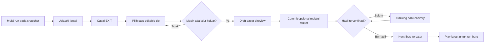

# Game Design — Menjelajahi dan Mengubah Reruntuhan

Status: aturan inti diwarisi; presentasi dan tuning di sini merupakan usulan. Lihat [PRD](PRD.md).

## 1. Fantasi pemain

Pemain adalah penjelajah yang menemukan jalan melalui satu bagian reruntuhan kuno. Setelah lolos, ia dapat membentuk ulang satu bagian kecil bangunan itu. Kontribusi seorang pemain menjadi kondisi awal bagi pemain yang mulai berikutnya.

Lentera, rune, debu, dan bangunan runtuh adalah bahasa visual. Lentera tidak membatasi pandangan secara mekanis, rune tidak memberi kekuatan, dan dekorasi tidak menambah collision.

## 2. Core loop dan batas pengalaman



Diagram menyederhanakan hasil reject/revert/cancel/reorg; perilaku lengkap mengikuti [UX](UX_AND_ACCESSIBILITY.md) dan ADR-030/031.

## 3. Peta, tile dan indeks

Semua aturan memakai koordinat grid logis. Gambar isometrik tidak mengubah indeks.

```text
00 01 02 03 04 05 06
07 08 09 10 11 12 13
14 15 16 17 18 19 20
21 22 23 24 25 26 27
28 29 30 31 32 33 34
35 36 37 38 39 40 41
42 43 44 45 46 47 48
```

Peta seed kanonik:

```text
S#.#...
.....#.
.####..
#.....#
##..#.#
.....#.
##....E
```

Sumber tunggal nilai: [fixtures](../reference/fixtures.json). Dokumentasi ini bukan fixture baru.

| Konsep | Perilaku |
|---|---|
| Floor | Bisa diinjak; beberapa variasi visual boleh memiliki aturan yang sama. |
| Wall | Tidak bisa diinjak; penampakan retak/lumut tidak membuatnya dapat dilewati. |
| START | Tile 0, tempat run dimulai. |
| EXIT | Tile 48, tujuan; mencapai tile ini mengakhiri pergerakan run. |
| Editable tile | Kotak yang bit-nya aktif dalam editable mask, terlepas dari wall/floor saat ini. |
| Dekorasi | Murni visual; tidak boleh tampak seperti penghalang tambahan pada floor. |

## 4. Mengapa tetap 7×7

Board kecil membuat semua rute dapat diperiksa dalam satu layar dan perubahan satu tile terasa langsung. Validator onchain memeriksa ruang terbatas 49 tile. Mempertahankan ukuran menghindari perubahan kontrak dan mengisolasi evaluasi peningkatan visual.

Kelemahannya: pemain dapat menghafal rute, puzzle dapat diselesaikan cepat, dan variasi susunan terbatas. Aset lebih bagus tidak otomatis menyelesaikan replayability. Ukuran dipertahankan untuk tahap ini agar perubahan pengalaman dapat dievaluasi sebelum mengubah mekanik.

## 5. Pergerakan

- Empat arah logis U/R/D/L; tidak ada diagonal logis atau analog movement.
- WASD dan arrows memetakan ke aturan lama. Pada proyeksi usulan, arah visualnya NW/NE/SE/SW.
- Input diterima hanya ketika board fokus dan domain mengizinkan move.
- Pergerakan ke wall atau melewati batas tidak menambah langkah.
- Berputar/idle/animasi benturan tidak ditambahkan ke path.
- Revisit boleh; tidak ada penalti uang, health atau waktu.
- Path maksimal 96 langkah. Batas ini adalah panjang run, bukan 96 detik.
- EXIT harus menjadi posisi akhir; game tidak mengizinkan berjalan keluar dari EXIT dalam run yang sama.

Timer bila ditambahkan adalah informasi lokal. Timer tidak dipakai membuktikan pemain manusia atau menentukan hadiah.

## 6. Animasi dan game feel

| Situasi | Feedback usulan | Hubungan dengan logika |
|---|---|---|
| Diam | Idle ringan, lentera bergerak pelan. | Tidak mengubah posisi. |
| Move legal | Sprite berjalan 120 ms antar pusat tile. | State sudah diperbarui; tween mengikuti state. |
| Menabrak wall | Gerakan pendek/ikon benturan dan suara pelan. | Posisi/path tetap. |
| Batas papan | Feedback sejenis tanpa jatuh. | Tidak ada death atau restart paksa. |
| EXIT | Cahaya pintu dan pesan local escape. | Run sudah selesai secara lokal. |
| Pilih tile | Outline diamond dan ghost hasil. | Satu edit draft, bukan mutation. |
| Confirmed mutation | Efek build/break 250–400 ms pada layer hasil kontribusi. | Hanya setelah observer mengonfirmasi. |

Tuning durasi adalah starting point. Reduced motion memakai perubahan langsung atau fade singkat, tanpa mengubah hasil permainan.

## 7. Editor satu tile

Konfigurasi kanonik mengizinkan 23 tile:

`8, 9, 10, 11, 14, 15, 16, 21, 22, 23, 24, 25, 26, 29, 30, 31, 32, 35, 36, 37, 38, 39, 40`.

Dalam implementasi, baca mask dari snapshot yang diverifikasi; jangan hardcode daftar ini untuk deployment lain. START/EXIT dan tile di luar mask tidak menjadi target edit.

Sesudah local escape:

1. Pemain memilih satu tile yang diizinkan.
2. Floor menghasilkan usulan wall; wall menghasilkan usulan floor.
3. Pemain melihat status “Escape route remains open” atau alasan invalid.
4. Memilih tile lain mengganti pilihan, bukan melakukan edit kedua.
5. Pemain boleh membatalkan tanpa transaksi.

Pemain tidak perlu berdiri di tile target dan tile target tidak harus berada di path yang baru dilalui. Hak memilih berasal dari local escape dan mask, bukan jarak karakter.

## 8. Skenario konkret

### 8.1 Menutup satu jalur

Pada seed, Player A memainkan `DRRRRURRDDLDLLDDRDRR`, 20 langkah, lalu memilih tile 31. Tile itu floor dan perubahan menjadi wall masih solvable. Commit valid menghasilkan revisi 1 dengan walls `0xd05b827900a`.

Player B memulai revisi 1, memainkan fixture 22 langkah `DRRRRURRDDLDLLLDDRRDRR`, lalu menutup tile 38. Hasil revisi 2 adalah `0xd45b827900a`.

20 dan 22 adalah panjang rute fixture, **bukan klaim shortest path**. Render harus menunjukkan perubahan persis pada indeks 31 lalu 38.

### 8.2 Membuka wall

Pada seed, tile 15 adalah wall dan editable. Mengubahnya menjadi floor tetap solvable. Preview menampilkan lantai di tempat wall serta tanda draft. Efek runtuh penuh digunakan untuk hasil kontribusi setelah terverifikasi, bukan untuk mengklaim commit saat baru hover.

### 8.3 Menutup semua rute

Pada seed, tile 8 adalah floor editable, tetapi menjadikannya wall menghilangkan seluruh jalur START→EXIT. UI tetap boleh menunjukkan ghost invalid untuk menjelaskan pilihan, namun tidak mengizinkan prepare/commit. Panggilan langsung ke kontrak juga harus ditolak.

### 8.4 Mengubah tile yang pernah diubah

Tile dapat ditoggle berkali-kali. Tidak ada “kotak sudah terpakai”. Satu pemain boleh kembali bermain pada revisi terbaru dan mengusulkan perubahan lain; saat ini tidak ada kuota identitas atau cooldown.

Peta bisa kembali ke wall mask sebelumnya, tetapi revision dan history tetap berbeda. Kesamaan rupa tidak berarti riwayat dihapus.

### 8.5 Semua tile dibuka atau ditutup

Semua 49 tile tidak dapat diubah bebas karena mask tetap. Peta penuh wall tidak valid. Membuka banyak editable tile mungkin membuat dungeon terlalu mudah, walaupun sah. Solvability menjamin keberadaan jalur, bukan tingkat kesulitan atau kualitas desain.

### 8.6 Pemain lain lebih dahulu commit

Run mempertahankan snapshot. HUD menunjukkan playing revision N dan live revision N+1. Pemain dapat menyelesaikan latihan, tetapi tidak dapat menerapkan path lama ke live dungeon. **Restart** tetap memakai snapshot lama; **Play latest** memulai snapshot baru.

### 8.7 Kontribusi sendiri diikuti perubahan orang lain

Kontribusi pada N+1 tetap dapat dikonfirmasi walaupun live sudah N+2. Layer hasil kontribusi harus dilabeli N+1. Jangan menampilkan wall mask N+1 sebagai live N+2 atau mengganti run tanpa tindakan pemain.

## 9. Menghindari kebingungan visual

- Floor yang terang atau berlumut tetap harus terbaca sebagai floor.
- Rubble dekoratif tidak boleh menyerupai wall yang memblokir.
- Wall transparan karena occlusion tetap wall secara logis.
- Ghost wall mempunyai outline/label draft; tidak dianggap collision baru.
- Pintu keluar bersinar tetapi tidak menarik karakter otomatis ke EXIT.
- Tidak memakai fog of war yang menyembunyikan aturan atau menyiratkan solusi rahasia.
- Jangan menambahkan monster bergerak sebagai dekorasi yang disangka harus dihindari.

## 10. Replayability dan batas desain

Daya tarik yang diuji adalah pengaruh terhadap dungeon bersama dan rasa penasaran terhadap perubahan berikutnya. Risiko desain: bolak-balik edit, jalur terlalu mudah, hafalan, bot solver, dan contention satu shared dungeon.

Pengembangan visual tidak menambahkan pembatas baru untuk mengatasi risiko tersebut. Kumpulkan observasi terlebih dahulu: apakah pemain memulai run kedua, memahami dampak edit, atau hanya memilih perubahan acak. Seasons, beberapa room, edit cooldown dan puzzle score memerlukan rancangan serta ADR tersendiri bila dipilih kemudian.

## 11. Checklist penerimaan desain

- Pemain dapat menjelaskan tujuan sebelum membuka wallet.
- Pemain memahami bahwa selesai lokal belum sama dengan perubahan bersama.
- Semua tile yang diizinkan dapat ditemukan melalui board dan daftar DOM.
- Preview valid/invalid dapat dijelaskan dengan teks yang terlihat.
- Karakter, wall dan EXIT tetap terbaca pada semua snapshot fixture.
- Tidak ada perubahan mekanik tersembunyi melalui aset atau animasi.
