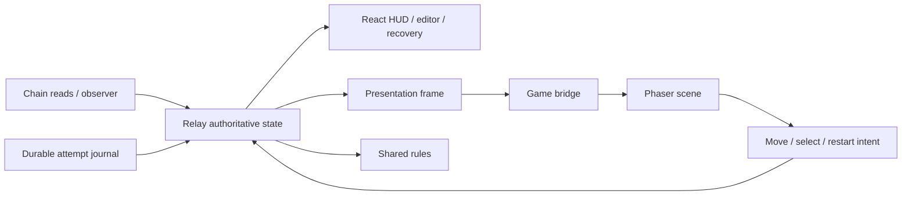

# Rancangan Teknis — Phaser 4 Game Presentation

Status: rancangan yang sudah diterapkan pada implementasi lokal. Interface konseptual di bawah menjelaskan kebutuhan; API aktual yang lebih kecil terdapat pada [presentation.ts](../src/game/presentation.ts), [Board](../src/game/Board.tsx), [GameBridge](../src/game/GameBridge.ts), dan [DungeonScene](../src/game/DungeonScene.ts). Bukti pengujian ada di [validation record](VALIDATION_RECORD.md).

## 1. Prinsip implementasi

Presentasi menerima state; domain menerima intent. Rules tetap memutuskan legalitas. Scene boleh menyimpan data untuk menggambar dan animasi, tetapi tidak membuat RPC client, mengirim transaksi, mengubah journal atau menghitung status konfirmasi sendiri.

Pengembangan berpusat pada `src/game/`, adapter `Board.tsx`, dan integrasi kecil di `App.tsx`/CSS. Perubahan relay dilakukan hanya bila diperlukan untuk boundary yang jelas, dengan regression test. Tidak perlu rewrite chain/journal/wallet untuk mengganti renderer.

## 2. Baseline dan perubahan yang diusulkan

| Bagian existing          | Keadaan                                                   | Perubahan yang direncanakan                                             |
| ------------------------ | --------------------------------------------------------- | ----------------------------------------------------------------------- |
| `src/game/Board.tsx`     | Inline scene, Canvas, graphics tegak, redraw destroy-all. | Host/bridge Phaser 4, delegated scene/projection/input.                 |
| `src/lib/rules/index.ts` | Rules/codec/solvability pure.                             | Reuse; tidak duplikasikan collision di physics engine.                  |
| `src/lib/model.ts`       | Snapshot, Run, Attempt, Mutation.                         | Pertahankan model; tipe presentasi ditempatkan terpisah.                |
| `src/lib/relay.ts`       | Authority run/selection/eligibility/commit.               | Tetap menjadi penerima intent; expose view lock/reason bila dibutuhkan. |
| `src/App.tsx`            | HUD, editor DOM, wallet/recovery/history.                 | Kirim selected tile, lock/phase dan callback selection ke Board.        |
| `src/style.css`          | Host square untuk board saat ini.                         | Sesuaikan aspect ratio, layout, loading/fallback, focus ring.           |
| `package.json`/lockfile  | Phaser 3.90.0.                                            | Exact Phaser 4 yang lolos spike.                                        |

## 3. Modul minimal yang diusulkan

```text
src/game/
  Board.tsx                  # React host, props, readiness/error DOM
  GameBridge.ts              # lifecycle, frame updates, callback wiring
  DungeonScene.ts            # object creation, visual updates, camera
  projection.ts              # project, inverse/pick, bounds, facing
  input.ts                   # focus gates, DOM-event dedupe, intents
  assets.ts                  # manifest keys, load groups, animation names
  presentation.ts            # view model/types and status derivation
```

Jangan membuat kelas/service untuk setiap tile, tween atau status. Wall/player/preview renderer boleh diekstrak bila scene menjadi sulit dibaca, bukan sebagai prasyarat tujuh lapisan arsitektur.

## 4. Aliran data



Observer/relay changes frame. Tween completion hanya mengubah transient visual, tidak kembali sebagai intent domain.

## 5. Presentation frame

Shape konseptual berikut menunjukkan kontrak boundary; bukan spesifikasi API engine:

```ts
interface GameFrame {
  generation: number; // membatalkan pekerjaan visual run lama
  run: Readonly<Run>;
  selectedTile?: number;
  interaction: {
    canMove: boolean;
    canSelect: boolean;
    canRestart: boolean;
    blockedReason?: string;
  };
  draft?: { tile: number; walls: bigint; solvable: boolean };
  liveRevision?: bigint;
  stale: boolean;
  attempt?: { id: string; state: AttemptState };
  contribution?: Readonly<Mutation>;
  preferences: { reducedMotion: boolean; muted: boolean };
}
```

Frame dibuat dari state relay dan fungsi rules. `draft.walls` berasal dari preview, tidak dipersist sebagai canonical board. Jangan kirim private wallet metadata ke scene. Hash/links dapat tetap dikelola DOM; scene hanya memerlukan identitas contribution untuk efek.

Existing `Run` tidak memiliki generation/id. Generation adalah nomor transient pada bridge/view adapter yang bertambah saat snapshot diganti, Restart, Play latest, atau restore run membatalkan visual sebelumnya. Jangan menambah generation ke jurnal tanpa kebutuhan migrasi yang dibuktikan.

Jika adapter belum menerima command acknowledgment, gunakan perubahan snapshot/path-prefix/position untuk mendeteksi discontinuity. Untuk Restart/Play latest yang state akhirnya identik, callback reset visual eksplisit tetap diperlukan agar tween lama tidak hidup kembali. Semua command tetap diperiksa relay; visual reset hanya dilakukan ketika domain menerima perubahan/keadaan reset.

## 6. Kontrak bridge dan intent

Operasi konseptual:

- Create: terima host, callbacks dan frame awal.
- `setFrame(frame)`: idempotent untuk frame yang sama; jangan me-recreate game.
- Ready/error callback: perbarui DOM loading/error tanpa memutasi run.
- Destroy: idempotent; semua resource dilepaskan.

Callbacks: `onMove(Direction)`, `onSelectTile(number)`, `onRestart()`. Pointer hover tidak memanggil `onSelectTile`. Callback restart tidak otomatis memanggil Play latest. Scene tidak mempunyai callback `onConfirmed` yang dapat mengesahkan transaksi.

Gate scene meningkatkan UX; gate relay tetap wajib karena frame/callback dapat stale. Intent yang ditolak tidak dianimasikan sebagai gerakan legal.

## 7. Input dan deduplikasi

1. Board host harus memiliki fokus atau descendant yang diizinkan.
2. Abaikan input jika target adalah textbox, select, tombol editor/modal wallet atau area DOM lain.
3. Abaikan kombinasi Ctrl/Meta/Alt dan event composition.
4. Gunakan mapping canonical U/R/D/L dari camera spec.
5. Identitas DOM KeyboardEvent yang sama diproses maksimal satu kali. Existing WeakSet fix dipertahankan atau diganti mekanisme setara yang dibuktikan tes.
6. `event.repeat` diabaikan pada baseline P0 agar tahan tombol tidak menghasilkan banjir; keydown baru tetap diterima. Ini tuning input yang harus diuji, bukan perubahan codec.
7. `preventDefault` hanya ketika board menangani tombol, agar halaman/form tetap bekerja di luar board.
8. Blur/visibility change membersihkan held-key state/hover; tidak menghapus run.

Tidak ada polling gerakan tiap frame yang menambah path berdasarkan state “key is down”. Dua keydown berbeda yang legal harus menghasilkan dua langkah walau requestAnimationFrame sedang pause.

## 8. Gerakan dan queue visual

Domain state diperbarui sinkron oleh relay ketika input legal. Scene membandingkan run sebelumnya dan berikutnya:

- Snapshot sama, path baru mempunyai prefix path lama: perubahan merupakan urutan move yang dapat dianimasikan.
- Snapshot/generation berbeda, path memendek, prefix berbeda atau restore: cancel tween, clear queue, snap ke posisi authoritative.
- Metadata live saja berubah: jangan reset player atau floor run.

Queue awal maksimal **4 segmen visual**. Jika input legal membuat backlog lebih panjang, fast-forward representasi ke posisi authoritative terbaru dan bersihkan backlog; langkah domain tetap lengkap. Feedback visual boleh mengorbankan sebagian tween, bukan sebagian path.

Setiap tween membawa generation token. Callback completion harus memeriksa token sebelum mengubah visual. Restart saat tween aktif segera menempatkan karakter di START dan memastikan callback lama tidak mengembalikannya ke tile sebelumnya.

Saat EXIT authoritative tercapai, editor DOM boleh aktif langsung; scene menyelesaikan segmen pendek terakhir jika aman. Jika pemain memilih draft sebelum tween selesai, scene snap ke EXIT lalu render draft. Animation state tidak menahan hak edit atau membuka commit.

## 9. Rendering stateful yang kecil

- Buat floor objects sekali setelah assets critical siap.
- Wall objects diperbarui berdasarkan mask diff atau snapshot replacement.
- Player sprite/bayangan dipertahankan; update facing/position/animation.
- Preview adalah kelompok terpisah, hanya satu target.
- UI/status text kritis tetap DOM.
- Jangan `children.removeAll(true)` setiap input karena akan mereset animasi dan menambah churn.

Untuk 49 tile, loop penuh membandingkan bitmask masih sederhana dan cukup. Tidak perlu ECS, worker, spatial database atau custom GPU renderer. Optimasi lanjut harus berdasarkan profil, bukan asumsi.

## 10. Depth, picking dan occlusion

Semua memakai [camera spec](CAMERA_AND_PROJECTION.md). Projection module adalah satu-satunya pemilik rumus forward/inverse; rules module tetap satu-satunya pemilik index/domain movement.

Physics Arcade/Matter tidak diperlukan untuk collision grid P0. Tile sprite yang transparan tetap wall jika bitmask menyatakannya wall. Pointer memilih footprint, lalu relay memeriksa editable mask dan phase.

Saat karakter bergerak, sorting memakai kaki interpolated. Occlusion memeriksa sprite silhouette terhadap wall di depan; low-wall/cutaway fallback tersedia bila alpha treatment tidak cukup. Detail polygon diuji pada style sample nyata.

## 11. Draft, confirmation dan live

Base layer: `run.snapshot.walls`, selalu.

Draft layer: candidate dari satu selected tile; tidak ada hak menulis ke base.

Contribution layer: efek/preview hasil contribution terverifikasi, berlabel revision contribution. Tidak menjadi live secara otomatis. Sesudah efek selesai, hilangkan layer efek atau pertahankan hasil dalam preview berlabel; jangan membiarkan floor/wall base berbeda dari run snapshot tanpa label.

Live badge: revision dan stale state dari relay. Jika live N+2 sedangkan contribution N+1, tampilkan keduanya dalam DOM. **Play latest** memuat live mask baru, mengosongkan path/draft lama dan mengganti base atomik.

Efek contribution dideduplikasi dengan identitas `(chainId, contract, txHash, logIndex, blockHash)`. Rerender/polling tidak memainkan efek berulang. Saat confirmation ditarik, hilangkan success cue; pemeriksaan inclusion kembali yang benar boleh memunculkan state confirmation lagi. Tidak mempersist effect history sebagai sumber konfirmasi.

## 12. Lifecycle React dan loader

1. Mount host: buat satu bridge dan mulai lazy import Phaser.
2. Bila unmount sebelum import selesai, jangan membuat instance sesudahnya.
3. Loader memuat critical atlas/frame; optional audio/decal tidak menahan readiness.
4. Frame terbaru disimpan selama loading; setelah create pakai frame terbaru, bukan props mount pertama.
5. Ready hanya sesudah board, player, projection dan input tersedia.
6. ResizeObserver mengubah camera fit, bukan run.
7. Unmount: disconnect observer, hapus listeners, cancel tween/timer, stop audio, destroy game, kosongkan ref.

React development remount/StrictMode harus aman. Jangan bergantung pada satu mount sepanjang browser session. Global cache texture yang masih dimiliki game instance lama tidak dipakai tanpa ownership yang jelas.

## 13. Kegagalan aset dan WebGL

| Gangguan               | Presentasi                                                                                     | State domain                       |
| ---------------------- | ---------------------------------------------------------------------------------------------- | ---------------------------------- |
| Optional texture gagal | Gunakan base variant/skip decor.                                                               | Tetap.                             |
| Critical atlas gagal   | Pesan loading error, retry terbatas/aksi Retry; placeholder original bila mapping tetap andal. | Run/journal tetap.                 |
| Phaser import gagal    | DOM error dan retry/remount terkendali.                                                        | Tidak otomatis reset attempt.      |
| WebGL init gagal       | DOM penjelasan, status/recovery masih dapat dibaca.                                            | Jangan minta signature dari scene. |
| Context lost           | Pause input scene, pesan reconnect visual; rebuild dari frame authoritative setelah restore.   | Tidak dianggap tx gagal/reorg.     |
| RPC gagal              | Label offline/status via relay.                                                                | Rules recovery existing tetap.     |

Error renderer tidak boleh memicu clear site data, menghapus localStorage atau membuat contract state practice tampak sebagai deployment live.

## 14. Audio dan preferences

Default mute usulan true untuk first visit; satu tombol “Sound” untuk opt-in. Preferences presentasi boleh memakai localStorage namespace berbeda dari journal, dan kegagalan save tidak menghalangi local play.

Unlock audio hanya setelah gesture. Mengganti tab menghentikan ambience sesuai preferensi; tidak menghapus attempt. Reduced motion meniadakan shake, dust loops dan walk tween panjang. Semua informasi tetap tersedia melalui visual statis/teks.

## 15. Performa dan resource

- Pertahankan Phaser lazy import dan critical asset group kecil.
- Tidak memuat engine 3D kedua atau library isometric pihak ketiga tanpa kebutuhan.
- Partikel dibatasi dan tidak dibuat perframe tanpa cleanup.
- Texture reuse, stable objects, dan mask diff mendahului optimasi custom.
- Catat main/Phaser bundle, asset compressed transfer dan decoded texture memory secara terpisah.
- Bandingkan dengan baseline pada perangkat/profil yang sama; FPS target bukan klaim universal.

## 16. Keamanan integrasi yang dipertahankan

- Vite deny rule untuk file operator tetap berlaku; jangan memindahkan `.local` ke public assets.
- Scene tidak menerima seed phrase/private key/API secret.
- URL asset berasal dari path bundle/manifest yang dikendalikan repo, bukan alamat arbitrary dari event pemain.
- Commit eligibility, journal durability, Web Locks, original-hash/nonce evidence dan canonical receipts tidak dipermudah untuk animasi.
- Mengganti akun/chain tetap mengikuti attempt scope existing.
- Tidak ada transaksi dari click tile; click hanya memilih draft. Signing tetap tindakan DOM terpisah.

## 17. Bukti sebelum integrasi selesai

Projection/picking tests, input frame-pause regression, restart-mid-tween, frozen snapshot, tile 31/38, invalid tile 8, local escape, journal recovery dan confirmation/reorg semuanya harus mempunyai hasil pada commit implementasi. Lihat [test plan](TEST_PLAN.md).
